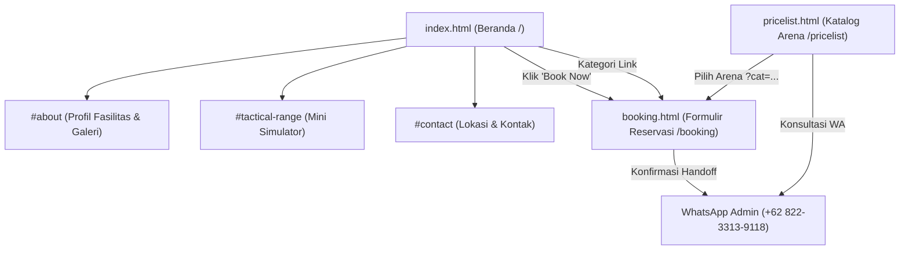

# DOKUMEN 1 — PROFIL DAN GAMBARAN UMUM WEBSITE
## SISTEM PROFIL BISNIS, SIMULATOR INTERAKTIF, DAN RESERVASI ONLINE
### DREAMFIELD TACTICAL SURABAYA

---

## DAFTAR ISI
1. [Judul dan Deskripsi Singkat Proyek](#1-judul-dan-deskripsi-singkat-proyek)
2. [Latar Belakang dan Konteks Proyek](#2-latar-belakang-dan-konteks-proyek)
3. [Tujuan Pengembangan Website](#3-tujuan-pengembangan-website)
4. [Sasaran Pengguna](#4-sasaran-pengguna)
5. [Kebutuhan Pengguna yang Dijawab Sistem](#5-kebutuhan-pengguna-yang-dijawab-sistem)
6. [Gambaran Umum Fungsi Website](#6-gambaran-umum-fungsi-website)
7. [Struktur Halaman dan Navigasi](#7-struktur-halaman-dan-navigasi)
8. [Ringkasan Fitur Utama](#8-ringkasan-fitur-utama)
9. [Ringkasan Arsitektur Teknologi](#9-ringkasan-arsitektur-teknologi)
10. [Ruang Lingkup Sistem](#10-ruang-lingkup-sistem)
11. [Batasan Sistem](#11-batasan-sistem)
12. [Ringkasan Hasil Audit dan Klasifikasi Bukti](#12-ringkasan-hasil-audit-dan-klasifikasi-bukti)
13. [Kesimpulan](#13-kesimpulan)

---

## 1. JUDUL DAN DESKRIPSI SINGKAT PROYEK

- **Judul Proyek**: Website Profil Bisnis, Simulator Interaktif, dan Sistem Reservasi Mandiri Dreamfield Tactical Surabaya.
- **Nama Entitas Bisnis**: DREAMFIELD TACTICAL (Airsoft Sports & CQB Tactical Arena).
- **Lokasi Fisik Arena**: The Central Mall Gunawangsa Tidar, Lantai Indoor, Jl. Tidar No. 350, Surabaya, Jawa Timur (±2,8 km dari Tunjungan Plaza). *(Informasi lokasi tertera pada antarmuka website dan Google Maps)*.
- **URL Publik Website**: `https://dreamfield.vercel.app` *(Terverifikasi melalui pengujian peramban)*.
- **Repositori Kode Sumber**: Repositori lokal Git (Branch: `main`, commit `6d3fec2`).

### Deskripsi Ringkas
Website Dreamfield Tactical dirancang sebagai platform web profil bisnis yang memadukan penyajian informasi arena, media edukasi visual olahraga airsoft, simulasi interaktif menembak sasaran (*Mini Shooting Range Simulator*), katalog harga seluruh arena, formulir reservasi mandiri 4-tahap dengan kalkulator estimasi tarif seketika (*live dynamic calculator*), serta layanan bantuan percakapan berbasis kecerdasan buatan (*AI Customer Service Chatbot*) "Mindream".

Website ini dirancang untuk menjawab kendala calon pelanggan arena airsoft, terutama terkait transparansi biaya sewa, pemahaman mengenai keamanan bagi pemula, serta kemudahan alur pengajuan jadwal reservasi.

---

## 2. LATAR BELAKANG DAN KONTEKS PROYEK

Olahraga airsoft dan simulasi pertempuran taktis jarak dekat (*Close Quarter Battle* / CQB) di perkotaan seperti Surabaya memiliki minat yang terus berkembang, baik untuk kegiatan rekreasi pertemanan, latihan ketangkasan, maupun aktivitas kebersamaan kelompok (*team building*).

Berdasarkan analisis kebutuhan fungsional dan konteks alur bisnis arena rekreasi taktis, terdapat beberapa kendala mendasar yang sering dialami oleh calon pengunjung:
1. **Asumsi Bahwa Airsoft Berbahaya dan Mahal**: Calon pengunjung pemula kerap berasumsi bahwa olahraga airsoft rentan cedera atau memerlukan biaya pembelian unit senjata pribadi bernilai jutaan rupiah.
2. **Keterbatasan Transparansi Informasi Paket**: Pengunjung sering kali kesulitan memperoleh rincian biaya sewa arena, kepastian perlengkapan keselamatan (*vest*, helm, masker pelindung), jenis unit yang dipinjamkan (AEG, GBB, WGG), serta alokasi peluru BB yang disertakan.
3. **Pemesanan Jadwal Tidak Terstruktur**: Pengajuan jadwal yang dilakukan secara manual melalui obrolan pesan instan tanpa formulir terpandu sering menimbulkan salah pencatatan tanggal atau pengajuan jadwal di luar jam buka operasional.

Website Dreamfield Tactical hadir untuk mengatasi kendala tersebut dengan menyediakan media informasi yang terstruktur, transparan, dan dapat diakses langsung melalui perangkat seluler maupun komputer desktop.

---

## 3. TUJUAN PENGEMBANGAN WEBSITE

Berdasarkan hasil analisis terhadap kode sumber dan pengujian antarmuka website, tujuan pengembangan sistem adalah:
1. **Menyajikan Informasi Profil Bisnis Secara Terstruktur**: Menampilkan profil Dreamfield Tactical sebagai penyedia fasilitas arena CQB indoor di Surabaya dengan standar keamanan dan pendampingan wasit (*Game Marshal*).
2. **Menyediakan Transparansi Paket dan Tarif**: Menyajikan rincian harga untuk seluruh kategori kegiatan: *War Game CQB*, *Shooting Target Range*, *Tactical Coaching*, *Unit Coaching & Drill*, dan *Tactical Gear Rental*.
3. **Menghadirkan Simulasi Interaktif Edukatif**: Menyediakan game simulasi menembak 3 level di halaman utama untuk mengenalkan konsep membidik sasaran serta melatih disiplin membedakan target musuh dan sandera secara visual.
4. **Menyederhanakan Alur Pengajuan Reservasi**: Menyediakan formulir pemesanan 4 langkah dengan validasi jadwal otomatis (memblokir hari libur Selasa dan jam di luar 12.00–21.00 WIB) yang merangkai tiket siap kirim ke WhatsApp Admin resmi.
5. **Menyediakan Layanan Informasi Responsif**: Mengintegrasikan widget asisten virtual berbasis serverless (*Mindream*) untuk melayani pertanyaan seputar fasilitas, lokasi, dan harga paket.

---

## 4. SASARAN PENGGUNA

Sistem dirancang untuk melayani beberapa kelompok sasaran pengguna:
1. **Pengunjung Pemula dan Rekreasi Keluarga (First-Timers / Families)**: Pengunjung yang belum memiliki pengalaman bermain airsoft dan membutuhkan informasi jaminan keselamatan, pendampingan wasit, serta paket ramah pemula seperti *Water Gel Gun* (WGG) atau *Shooting Target*.
2. **Kelompok Pertemanan dan Komunitas CQB**: Tim yang ingin menyelenggarakan simulasi pertempuran taktis beregu dan memerlukan kejelasan opsi sewa unit otomatis (*AEG M4 CQB*) serta durasi sewa arena.
3. **Peminat Latihan Menembak Presisi (Target Shooters)**: Individu yang ingin melatih konsentrasi dan akurasi menembak di jalur target statis dan plat baja reaktif.
4. **Instansi atau Rombongan Perusahaan (Corporate Gathering)**: Kelompok kerja yang merencanakan kegiatan koordinasi tim dengan kebutuhan konsultasi paket rombongan.

---

## 5. KEBUTUHAN PENGGUNA YANG DIJAWAB SISTEM

Tabel berikut memetakan kebutuhan pengguna terhadap implementasi fitur sistem beserta klasifikasi bukti verifikasinya:

| Kebutuhan Pengguna | Solusi Fitur pada Website | Status Verifikasi |
| :--- | :--- | :--- |
| Ingin melihat dokumentasi visual fasilitas arena | **Arena Photo Gallery Slider** (`index.html`): Galeri 5 foto dokumentasi arena dengan kontrol navigasi dan gestur sentuh. | Teramati pada website & Terverifikasi dari source code |
| Ingin mencoba simulasi menembak secara interaktif | **Mini Shooting Range Simulator** (`index.html`): Simulasi menembak 3 level berbasis interaksi peramban. | Terverifikasi melalui pengujian & Terverifikasi dari source code |
| Mencegah kesalahan memilih hari saat arena libur | **Strict Tuesday Block Engine** (`booking.html`): Validasi kalender yang memblokir pemilihan hari Selasa secara otomatis. | Terverifikasi melalui pengujian & Terverifikasi dari source code |
| Mencegah pemilihan jam di luar jam operasional | **Operational Time Validation** (`booking.html`): Pembatasan jam kedatangan pada rentang 12.00–21.00 WIB. | Terverifikasi melalui pengujian & Terverifikasi dari source code |
| Mengetahui total biaya saat jumlah pemain berubah | **Live Dynamic Price Calculator** (`booking.html`): Perhitungan perkalian tarif seketika saat jumlah pemain diubah. | Terverifikasi melalui pengujian & Terverifikasi dari source code |
| Membutuhkan respon cepat atas pertanyaan umum | **AI CS Chatbot Mindream** (`api/chat.js` & `assets/js/cs-bot.js`): Layanan obrolan interaktif terintegrasi Groq dan Gemini. | Terverifikasi melalui pengujian & Terverifikasi dari source code |

---

## 6. GAMBARAN UMUM FUNGSI WEBSITE

Alur interaksi fungsional website menghubungkan tiga halaman utama dengan saluran WhatsApp resmi:

```
+-------------------------------------------------------------------------+
|                  WEBSITE DREAMFIELD TACTICAL SURABAYA                   |
|                    (https://dreamfield.vercel.app)                      |
+-------------------------------------------------------------------------+
       |                               |                       |
       v                               v                       v
[ index.html ]                 [ pricelist.html ]      [ booking.html ]
- Pembuka Visual Taktis        - Katalog Visual Arena  - Formulir Reservasi 1-4
- Nilai Keunggulan Layanan     - Deep-link ke Booking  - Kalkulator Biaya Langsung
- Galeri Foto Arena            - Tautan Konsultasi WA  - Validasi Aturan Jadwal
- Mini Range Simulator                                 - Perakitan Tiket WhatsApp
- Informasi Venue & Jam Buka                           - Modal Konfirmasi Transisi
- Chatbot Mindream (Dual-AI)
```

1. **Halaman Beranda (`index.html`)**: Menyajikan gambaran umum profil bisnis, pameran galeri fasilitas, simulator menembak interaktif, jam buka, dan titik lokasi venue.
2. **Halaman Katalog Arena (`pricelist.html`)**: Menyajikan perbandingan visual 5 kategori arena pertempuran yang dapat diteruskan langsung ke formulir reservasi dengan kategori terkait otomatis terpilih.
3. **Halaman Reservasi Mandiri (`booking.html`)**: Memproses pilihan paket, jadwal kunjungan, identitas pemesan, dan estimasi biaya ke dalam bentuk draf tiket WhatsApp yang terformat rapi.

---

## 7. STRUKTUR HALAMAN DAN NAVIGASI

### Peta Situs (Sitemap)



### Konfigurasi URL dan Routing (Vercel Clean URLs)
Berdasarkan file konfigurasi `vercel.json` yang terverifikasi pada kode sumber:
- Akses ke `/` menyajikan dokumen statis `index.html`.
- Akses ke rute bersih `/booking` dialihkan oleh rewrite engine ke `booking.html`.
- Akses ke rute bersih `/pricelist` dialihkan oleh rewrite engine ke `booking.html`, sementara dokumen `pricelist.html` dapat diakses langsung melalui jalurnya.
- Parameter kueri URL didukung penuh untuk inisialisasi awal formulir, misalnya `booking.html?cat=target` atau `booking.html?cat=wargame`.

---

## 8. RINGKASAN FITUR UTAMA

1. **Tactical Opening & Header Status**:
   - Tampilan pembuka animasi bertema radar taktis dan bilah navigasi yang menempel di bagian atas saat halaman digulir (*sticky navbar*).
2. **Interactive Arena Photo Gallery Slider**:
   - Komponen slider 5 foto fasilitas arena dengan indikator nomor slide (`01/05`), tombol navigasi panah, dot indicator, dan dukungan gestur sentuh pada layar ponsel.
3. **Mini Shooting Range Game Simulator**:
   - Simulasi menembak target 3 tahap: Popper Baja (Tahap 1), Target Bergerak (Tahap 2), dan Musuh vs Sandera (Tahap 3), dengan timer 10 detik per tahap dan perhitungan persentase akurasi tembakan. Efek audio dinonaktifkan secara sengaja pada kode sumber demi kenyamanan peramban.
4. **Formulir Reservasi Mandiri 4-Tahap**:
   - Alur pengisian terstruktur: Tahap 1 (Pemilihan Arena & Paket), Tahap 2 (Jadwal & Personel), Tahap 3 (Data Narahubung), Tahap 4 (Konfirmasi & Pengalihan).
5. **Live Dynamic Price Calculator**:
   - Penghitung estimasi biaya otomatis di sisi peramban yang seketika mengalikan harga paket dengan jumlah pemain yang diinputkan.
6. **Engine Validasi Jadwal Operasional**:
   - Mencegah input tanggal lampau, menolak pemesanan hari Selasa (jadwal libur perawatan rutin), dan membatasi jam kedatangan pada pukul 12.00–21.00 WIB.
7. **WhatsApp Ticket Generator & Handoff Modal**:
   - Menyusun data formulir menjadi format pesan teks tiket terstruktur dengan garis pembatas rapi, menampilkan modal pratinjau, lalu mengalihkannya ke WhatsApp resmi Admin (`0822-3313-9118`).
8. **Asisten Virtual CS Dual-Engine (Mindream)**:
   - Widget obrolan interaktif yang diproses melalui Vercel Serverless Function (`api/chat.js`), mengintegrasikan Groq Cloud API sebagai pemroses utama dan Google Gemini sebagai cadangan otomatis, dengan simulasi mengetik alami bertahap.

---

## 9. RINGKASAN ARSITEKTUR TEKNOLOGI

Sistem menerapkan arsitektur terpisah antara antarmuka statis dan fungsi serverless (*Decoupled Static Serverless Architecture*):

```
+------------------------------------------------------------------------+
| LAPISAN ANTARMUKA PENGGUNA (Client Browser)                            |
| - Dokumen Statis HTML5 Semantik                                        |
| - Penataan Gaya CSS3 Murni (CSS Custom Properties & Media Queries)     |
| - Logika Sisi Klien: Vanilla JavaScript ES6+ (Zero Build Step)         |
| - Efek Audio Sintetis: Web Audio API (Osilator Frekuensi Bawaan)       |
+------------------------------------------------------------------------+
                                   |
         +-------------------------+-------------------------+
         | (Permintaan Halaman Statis)                       | (Panggilan Chat POST)
         v                                                   v
+-------------------------------+   +------------------------------------+
| INFRASTRUKTUR CDN             |   | LAPISAN SERVERLESS                 |
| - Vercel Edge Network         |   | - Vercel Serverless Function       |
| - Clean URLs Engine           |   | - File: /api/chat.js (Node.js)     |
| - Protokol HTTPS / SSL        |   | - Isolasi API Key & CORS           |
+-------------------------------+   +------------------------------------+
                                                              |
                                   +-------------------------+
                                   | Alur Failover Otomatis
                                   v
+------------------------------------------------------------------------+
| LAYANAN EKSTERNAL                                                      |
| - Mesin Utama AI: Groq Cloud API (qwen/qwen3.8-27b)                    |
| - Mesin Cadangan AI: Google Generative AI API (gemini-3.6-flash)       |
| - Saluran Transaksi: WhatsApp Universal URI Protocol (wa.me)           |
| - Navigasi Lokasi: Tautan Peta Google Maps Resmi                       |
+------------------------------------------------------------------------+
```

---

## 10. RUANG LINGKUP SISTEM

Ruang lingkup fungsionalitas yang terbukti ada dan aktif pada sistem mencakup:
- Penyajian informasi profil arena, jam operasional, dan lokasi fisik.
- Pameran dokumentasi foto asli fasilitas CQB dan area safe-zone.
- Penyediaan simulasi menembak target mini interaktif berbasis web.
- Penyajian katalog paket harga untuk 5 kategori arena.
- Kalkulasi estimasi total biaya sewa secara dinamis di peramban.
- Validasi kepatuhan jadwal terhadap hari libur dan jam buka operasional.
- Penyusunan tiket teks pemesanan dan pengalihan ke WhatsApp pengelola.
- Layanan tanya jawab pelanggan secara interaktif melalui chatbot AI.

---

## 11. BATASAN SISTEM

Secara objektif, batasan teknis dan operasional sistem saat ini mencakup:
1. **Ketiadaan Basis Data Server (*No Server-Side Database*)**:
   - Sistem tidak menyimpan riwayat formulir atau data transaksi di database terpusat (SQL maupun NoSQL). Data hanya diproses sementara di memori peramban klien sebelum dialihkan ke WhatsApp.
2. **Ketiadaan Pengecekan Slot Terisi Waktu-Nyata (*No Real-Time Slot Collision Check*)**:
   - Sistem memvalidasi kesesuaian jam buka (12.00–21.00 WIB), namun tidak dapat mendeteksi apakah suatu jam telah penuh dipesan oleh rombongan lain di lapangan. Konfirmasi ketersediaan slot tetap memerlukan pemeriksaan manual admin WhatsApp.
3. **Ketiadaan Gerbang Pembayaran Otomatis (*No Payment Gateway*)**:
   - Sistem tidak memproses transaksi pembayaran kartu kredit, virtual account, atau QRIS otomatis di dalam website. Pembayaran uang muka (DP) atau pelunasan diselesaikan melalui transfer bank manual yang disepakati via WhatsApp.
4. **Ketiadaan Autentikasi Pengguna (*No User Accounts*)**:
   - Tidak tersedia fitur pendaftaran akun, login, atau dasbor riwayat pesanan bagi pengguna.
5. **Ketergantungan terhadap Aplikasi Eksternal**:
   - Penyelesaian reservasi bergantung pada kepemilikan aplikasi WhatsApp aktif pada perangkat pengguna serta respon dari staf admin fisik.

---

## 12. RINGKASAN HASIL AUDIT DAN KLASIFIKASI BUKTI

Berdasarkan pemeriksaan kode sumber repositori lokal dan pengujian langsung pada website online (`https://dreamfield.vercel.app`), berikut adalah klasifikasi bukti faktual sistem:

- **Terverifikasi dari Source Code**:
  - Validasi kalender hari Selasa (`dateObj.getDay() === 2`) pada `booking.html:L4075`.
  - Pembatasan jam operasional 12.00–21.00 WIB pada `booking.html:L4100`.
  - Logika perhitungan harga paket dan perkalian personel pada `booking.html:L3852`.
  - Struktur failover Groq dan Gemini pada `api/chat.js:L90-L160`.
  - Isolasi kunci API di environment variable serverless.
  - Implementasi sintesis suara radio melalui Web Audio API pada `assets/js/cs-bot.js:L20`.
- **Terverifikasi melalui Pengujian**:
  - Halaman `index.html`, `booking.html`, dan `pricelist.html` dapat diakses normal melalui peramban.
  - Endpoint `/api/chat` merespon method `OPTIONS` dengan status 200 dan header CORS yang sesuai, serta menolak method `GET` dengan status 405.
  - Formulir pemesanan menolak konfirmasi jika tanggal hari Selasa atau jam di luar rentang dipilih.
  - Chatbot Mindream merespon pesan pengguna dengan balasan berpoin ringkas dan memunculkan tombol booking saat mendeteksi maksud reservasi.
- **Teramati pada Website (Klaim Konten Antarmuka)**:
  - Teks promosi seperti *"Arena CQB Indoor 1.200 m² Full AC"*, *"100% Safety Record"*, dan lencana *"Online 24/7"* pada widget obrolan.
  - Angka penghitung statistik: `2500+ Active Players` dan `50+ Rental Guns` pada elemen `#about`.
- **Belum Terverifikasi**:
  - Metrik statistik pemain riil (angka 2500+ tercatat sebagai atribut statis `data-target="2500"` pada kode HTML dan belum dihubungkan ke sistem analitik database transaksi).
  - Waktu muat absolut dan latensi jaringan end-to-end (belum diuji menggunakan alat uji performa sintetis/APM berstandar industri secara formal, meskipun pada peramban teramati responsif).
  - Pengukuran luas fisik arena secara langsung di lapangan (didasarkan pada klaim materi pemasaran resmi).

---

## 13. KESIMPULAN

Website Dreamfield Tactical Surabaya merupakan implementasi sistem web profil bisnis dan reservasi yang dirancang secara terarah untuk memenuhi kebutuhan operasional arena airsoft CQB.

Penerapan tumpukan teknologi web standar (HTML5, CSS3, dan Vanilla JavaScript) yang dipadukan dengan komputasi fungsi nirserver (*serverless*) Vercel terbukti mampu menghadirkan sistem yang responsif, berbiaya pemeliharaan infrastruktur rendah, dan bebas dari ketergantungan framework kompilasi yang rumit. Batasan sistem terkait ketiadaan database dan payment gateway otomatis telah diidentifikasi secara jelas sebagai karakteristik produk tahap awal (*MVP*) yang siap ditingkatkan pada fase pengembangan berikutnya.
