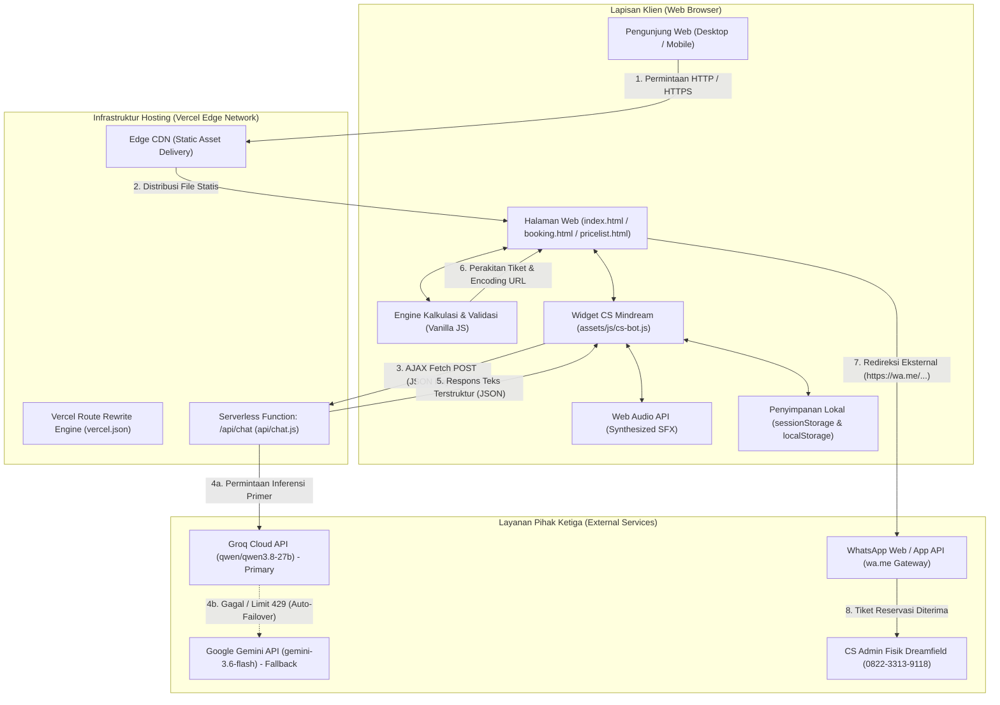
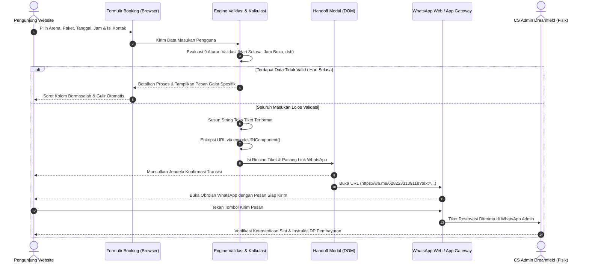
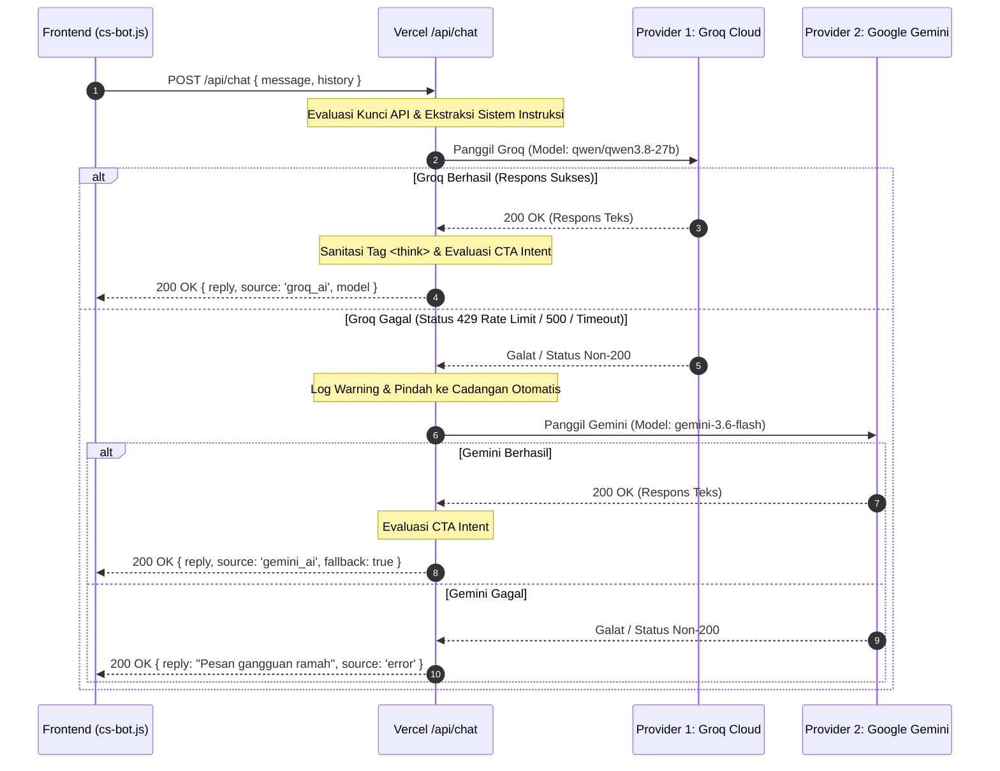

# DOKUMENTASI TEKNIS DAN ARSITEKTUR SISTEM
## Website Resmi Dreamfield Tactical Surabaya (https://dreamfield.vercel.app)

---

## DAFTAR ISI
1. [Pendahuluan dan Gambaran Arsitektur](#1-pendahuluan-dan-gambaran-arsitektur)
2. [Diagram Arsitektur Sistem Global](#2-diagram-arsitektur-sistem-global)
3. [Inventarisasi Struktur Direktori Proyek](#3-inventarisasi-struktur-direktori-proyek)
4. [Spesifikasi Tumpukan Teknologi (Tech Stack)](#4-spesifikasi-tumpukan-teknologi-tech-stack)
5. [Sistem Desain, Tipografi, dan Prinsip Rekayasa Tampilan](#5-sistem-desain-tipografi-dan-prinsip-rekayasa-tampilan)
6. [Mekanisme Routing dan Konfigurasi Deployment](#6-mekanisme-routing-dan-konfigurasi-deployment)
7. [Skema Data Katalog Paket (packageCatalog)](#7-skema-data-katalog-paket-packagecatalog)
8. [Algoritma Kalkulasi Harga dan Komputasi Sisi Klien](#8-algoritma-kalkulasi-harga-dan-komputasi-sisi-klien)
9. [Rule Engine Validasi Jadwal dan Batasan Operasional](#9-rule-engine-validasi-jadwal-dan-batasan-operasional)
10. [Spesifikasi dan Alur Data Reservasi WhatsApp (Handoff Flow)](#10-spesifikasi-dan-alur-data-reservasi-whatsapp-handoff-flow)
11. [Spesifikasi Lengkap Backend Serverless /api/chat](#11-spesifikasi-lengkap-backend-serverless-apichat)
12. [Strategi High-Availability Failover Dual-Engine AI (Groq & Gemini)](#12-strategi-high-availability-failover-dual-engine-ai-groq--gemini)
13. [Manajemen State dan Penyimpanan Sisi Klien (Client Storage)](#13-manajemen-state-dan-penyimpanan-sisi-klien-client-storage)
14. [Analisis Ketiadaan Basis Data Server (Stateless System Analysis)](#14-analisis-ketiadaan-basis-data-server-stateless-system-analysis)
15. [Aspek Keamanan, Sanitasi, dan Perlindungan Data Pribadi](#15-aspek-keamanan-sanitasi-dan-perlindungan-data-pribadi)
16. [Glosarium Istilah Teknis](#16-glosarium-istilah-teknis)

---

## 1. PENDAHULUAN DAN GAMBARAN ARSITEKTUR

Sistem website **Dreamfield Tactical Surabaya** mengadopsi pola arsitektur **Decoupled Static-Serverless Architecture** (Arsitektur Statis Terpisah Berbasis Serverless). Pola arsitektur ini memisahkan secara tegas antara lapisan penyajian visual (*presentation layer*), lapisan komputasi fungsi nirserver (*serverless computation layer*), dan saluran interaksi transaksi eksternal (*external transaction & communication channels*).

### Karakteristik Utama Arsitektur:
1. **Zero-Build Static Frontend**: Halaman web dibangun murni menggunakan dokumen HTML5 semantik, CSS3 murni dengan variabel tema terstandarisasi, dan Vanilla JavaScript ES6+. Sistem tidak memerlukan langkah kompilasi (*no npm build step, no bundler like Webpack/Vite*), sehingga waktu muat halaman (*Time to First Byte / TTFB*) sangat instan dan aset dapat didistribusikan langsung melalui jaringan pengantaran konten global (*Edge CDN*).
2. **Micro-Serverless AI Gateway**: Komputasi backend hanya diaktifkan saat terjadi panggilan permintaan kecerdasan buatan (*AI inference*) melalui fungsi serverless tunggal Node.js yang dihosting pada Vercel Serverless Functions (`/api/chat`).
3. **Dual-Engine High-Availability**: Layanan AI Customer Service mengimplementasikan mekanisme *automatic failover* bertingkat yang menjembatani dua penyedia model bahasa besar kelas dunia: Groq Cloud API (sebagai mesin inferensi utama berkecepatan tinggi) dan Google Gemini API (sebagai mesin cadangan otomatis).
4. **Stateless Conversational Booking Handoff**: Sistem reservasi beroperasi tanpa basis data SQL/NoSQL di sisi server aplikasi. Seluruh verifikasi, kalkulasi tarif, dan perakitan data terjadi di memori peramban klien, lalu dialihkan (*handoff*) secara aman ke aplikasi WhatsApp Admin resmi menggunakan skema URI universal terenkripsi.

---

## 2. DIAGRAM ARSITEKTUR SISTEM GLOBAL

Diagram berikut memvisualisasikan interaksi komponen arsitektur sistem dari peramban pengunjung hingga layanan eksternal:



---

## 3. INVENTARISASI STRUKTUR DIREKTORI PROYEK

Struktur direktori proyek dirancang secara modular dan efisien tanpa penumpukan dependensi node_modules lokal:

```
LANDING PAGE DREAM FIELD/
├── .env                                  # Kredensial lokal (API Keys - diabaikan di Git)
├── .gitignore                            # Konfigurasi pengecualian file Git
├── index.html                            # Halaman profil bisnis, galeri, mini-game (6.563 baris)
├── booking.html                          # Halaman formulir reservasi & live calculator (4.409 baris)
├── pricelist.html                        # Halaman katalog komparasi 5 arena pertempuran (932 baris)
├── vercel.json                           # Konfigurasi routing rewrite & clean URLs Vercel
├── api/
│   └── chat.js                           # Endpoint serverless function failover AI (247 baris)
├── assets/
│   ├── css/
│   │   └── cs-bot.css                    # Lembar gaya khusus widget CS Mindream (769 baris)
│   ├── js/
│   │   └── cs-bot.js                     # Logika klien CS Mindream & Web Audio API (610 baris)
│   └── img/                              # Direktori aset grafis lokal teroptimasi
│       ├── arena-coaching.jpg            # Foto arena tactical coaching
│       ├── arena-shooting-target.jpg     # Foto jalur target presisi 10-25 meter
│       ├── arena-unit-drill.jpg          # Foto kelas pengenalan unit drill
│       ├── arena-wargame.jpg             # Foto medan pertempuran CQB 1.200 m²
│       ├── community-squad-lineup.jpg    # Foto dokumentasi komunitas airsoft
│       ├── dreamfield-lime-badge.jpg     # Logo lencana grafis Dreamfield
│       ├── dreamfield-logo-orig.jpg      # Logo resmi Dreamfield Tactical
│       ├── gear-rental-armory.jpg        # Foto gudang persenjataan & tactical armor
│       ├── junior-shooting-lane.jpg      # Dokumentasi jalur tembak pemula
│       ├── mindream-avatar.jpg           # Avatar resmi admin Customer Service Mindream
│       ├── shooter-aiming-drill.jpg      # Dokumentasi latihan bidik presisi
│       ├── squad-team-cqb.jpg            # Dokumentasi pertandingan tim skirmish
│       ├── tactical-stage-photobooth.jpg # Area foto booth panggung taktikal
│       └── unit-coaching-drill.jpg       # Dokumentasi pelatihan mekanika unit
└── DOKUMENTASI_WEBSITE_DREAMFIELD/       # Direktori dokumentasi resmi sistem
    ├── 01_PROFIL_DAN_GAMBARAN_UMUM.md
    ├── 02_MANUAL_BOOK_PENGGUNA.md
    ├── 03_DOKUMENTASI_FITUR_DAN_ANTARMUKA.md
    ├── 04_DOKUMENTASI_TEKNIS_DAN_ARSITEKTUR.md
    ├── 05_HASIL_AUDIT_DAN_REKOMENDASI.md
    └── 06_LAPORAN_GABUNGAN_DAN_PRESENTASI.md
```

### Rincian Peran dan Tanggung Jawab File:
- **`index.html`**: Berfungsi sebagai portal pendaratan utama (*landing page*), memuat komponen navbar, presentasi brand, interaksi galeri slider, statistik bisnis, mini shooting simulator, dan informasi venue.
- **`booking.html`**: Mengelola seluruh alur reservasi, katalog paket interaktif, logika pembatasan kalender, perhitungan harga langsung, modal transisi, dan perakitan URL WhatsApp.
- **`pricelist.html`**: Halaman rujukan komparasi paket yang menyajikan 5 arena pertempuran dan menghubungkannya ke booking via kueri URL.
- **`api/chat.js`**: Satu-satunya modul backend yang mengeksekusi logika serverless Node.js, mengamankan kunci API, dan mengelola failover antara Groq dan Gemini.
- **`assets/js/cs-bot.js`**: Skrip pengendali widget CS yang diinjeksikan secara asinkron ke `index.html` dan `pricelist.html`.
- **`vercel.json`**: Menginstruksikan server Vercel untuk menerapkan URL bersih (*clean URLs*) dan merutekan alias `/booking` dan `/pricelist`.

---

## 4. SPESIFIKASI TUMPUKAN TEKNOLOGI (TECH STACK)

Sistem dibangun di atas fondasi teknologi web modern berstandar W3C:

| Lapisan Sistem | Teknologi / Komponen | Versi / Spesifikasi | Fungsi Utama |
| :--- | :--- | :--- | :--- |
| **Frontend Markup** | HTML5 Semantik | W3C Standard | Struktur dokumen (`<header>`, `<nav>`, `<section>`, `<main>`, `<footer>`) |
| **Frontend Styling** | Modern CSS3 | CSS Custom Properties | Penataan gaya bertema gelap (*dark tactical*), Grid, Flexbox, Glassmorphism |
| **Frontend Scripting** | Vanilla JavaScript | ECMAScript 2020+ (ES11) | Manipulasi DOM, validasi formulir, state lokal, penanganan gestur sentuh |
| **Audio Synthesis** | Web Audio API | W3C Recommendation | Sintesis gelombang audio murni (tanpa file mp3 eksternal) |
| **Ikonografi** | FontAwesome CDN | Versi 6.4.0 (SVG & Web Fonts) | Ikon antarmuka bertema militer, navigasi, dan indikator status |
| **Tipografi** | Google Fonts | Web Fonts (Inter, Montserrat, Orbitron) | Teks hierarki baca, judul taktis, dan display numerik HUD |
| **Backend Runtime** | Node.js Serverless | Node.js v18.x / v20.x | Eksekusi fungsi komputasi nirserver di infrastruktur Vercel |
| **AI Engine Primer** | Groq Cloud API | `qwen/qwen3.8-27b`, `qwen/qwen3.6-27b` | Mesin inferensi utama berbasis LPU untuk pemrosesan teks cepat |
| **AI Engine Cadangan** | Google Generative AI | `gemini-3.6-flash`, `gemini-3.5-flash` | Fallback otomatis jika kuota primer habis |
| **Deployment / CDN** | Vercel Platform | Vercel Global Edge Network | Hosting statis, SSL/TLS otomatis, manajemen serverless & DNS |
| **External Channel** | WhatsApp Click-to-Chat | Universal Protocol (`wa.me`) | Handoff data tiket ke tim operasional fisik |

---

## 5. SISTEM DESAIN, TIPOGRAFI, DAN PRINSIP REKAYASA TAMPILAN

### 5.1 Palet Warna Taktis (Tactical Design Tokens)
Sistem menggunakan variabel warna global yang dideklarasikan pada elemen `:root`:

```css
:root {
    --color-charcoal: #1A1A1A;       /* Latar belakang utama antarmuka */
    --color-black-deep: #111111;     /* Latar belakang kartu dan footer */
    --color-lime: #B7FF00;           /* Aksen primer taktis (tombol aksi, sorotan aktif) */
    --color-sage: #DDE5D1;           /* Warna teks utama dan judul sekunder */
    --color-moss: #8A9A5B;           /* Warna garis batas dan ikon netral */
    --color-olive: #4E5B31;          /* Warna garis pemisah dan aksen lembut */
    --color-error: #FF4444;          /* Warna indikator validasi galat dan penolakan */
    --color-surface-trans: rgba(26, 26, 26, 0.85); /* Efek kaca semi-transparan */
}
```

### 5.2 Standar Tipografi
1. **Font Judul & Header Taktis**: `Orbitron` dan `Montserrat` (bobot 700-900), berhuruf kapital (*uppercase*), spasi antarhuruf renggang (*letter-spacing: 1.5px*), membangkitkan nuansa display helm taktis militer (*Heads-Up Display*).
2. **Font Teks Bodi & Konten**: `Inter` (bobot 400-500, tinggi baris 1.6), memberikan kenyamanan baca maksimal (*readability*) pada layar beresolusi tinggi maupun rendah.
3. **Font Display Numerik & Skor**: Monospace dan Orbitron tabular, memastikan angka akurasi, waktu, dan counter tidak bergeser (*layout shift*) saat bertambah dinamis.

### 5.3 Titik Henti Responsif (Responsive Breakpoints)
Sistem menerapkan pendekatan desain adaptif (*fluid responsive*) dengan dua breakpoint utama:
- `@media (max-width: 768px)`: Mengalihkan navbar ke mobile drawer, menyusun grid kartu menjadi kolom tunggal, serta mengaktifkan Mobile Sticky Checkout Bar pada halaman booking.
- `@media (max-width: 480px)`: Menyesuaikan padding kontainer (16px), mengecilkan ukuran teks judul, dan mengoptimalkan ukuran target sentuh (*minimum touch target 44x44px*).

---

## 6. MEKANISME ROUTING DAN KONFIGURASI DEPLOYMENT

Routing dikelola melalui file konfigurasi deklaratif `vercel.json`:

```json
{
  "cleanUrls": true,
  "rewrites": [
    {
      "source": "/pricelist",
      "destination": "/booking.html"
    },
    {
      "source": "/booking",
      "destination": "/booking.html"
    }
  ]
}
```

### Analisis Cara Kerja Routing:
1. **`cleanUrls: true`**: Menghilangkan ekstensi `.html` dari bilah alamat peramban. Pengguna dapat mengakses `https://dreamfield.vercel.app/booking` secara elegan tanpa akhiran `.html`.
2. **`rewrites`**: Mengarahkan rute virtual `/booking` dan `/pricelist` secara langsung ke dokumen pemroses `booking.html`. Pada saat yang sama, file fisik `pricelist.html` tetap dapat diakses secara langsung melalui `https://dreamfield.vercel.app/pricelist.html`.
3. **Internal Hash Routing**: Pada halaman utama (`index.html`), navigasi seksi menggunakan anchor link HTML (`#about`, `#tactical-range`, `#contact`) yang dipadukan dengan API `history.scrollRestoration = 'manual'` guna menjamin posisi halaman selalu kembali ke puncak atas saat dimuat ulang (*anti-scroll jump*).

---

## 7. SKEMA DATA KATALOG PAKET (packageCatalog)

Seluruh definisi arena, varian unit, durasi, dan rincian fasilitas dikelola melalui objek JavaScript terstruktur `packageCatalog` pada `booking.html:L2970-L3240`.

### Struktur Skema Objek Katalog:

```javascript
const packageCatalog = {
    [categoryKey: string]: {
        catName: string,         // Nama resmi kategori arena (misal: "WAR GAME CQB")
        icon: string,            // Kelas ikon FontAwesome (misal: "fa-shield-halved")
        badge: string,           // Lencana keterangan (misal: "CQB 1.200m² Bertingkat")
        items: Array<{
            id: string,          // ID unik paket (misal: "wg-aeg-1h")
            name: string,        // Nama varian paket (misal: "Lapangan + AEG (1 Jam)")
            platform: string,    // Platform unit (misal: "Airsoft AEG M4 CQB")
            price: string,       // String tarif terformat (misal: "Rp 150.000")
            unit: string,        // Satuan sewa (misal: "/ Orang / Jam")
            badge?: string,      // Lencana opsional (misal: "TERPOPULER")
            desc: string,        // Deskripsi taktis paket
            features: string[]   // Rincian fasilitas yang disertakan (4-5 poin)
        }>
    }
}
```

### 5 Kategori Arena yang Terdaftar:
1. **`wargame`** (*WAR GAME CQB*): Memuat 6 paket (Sewa Lapangan 1 Jam, Sewa Lapangan 2 Jam, Paket WGG 1 Jam, Paket WGG 2 Jam, Paket AEG M4 1 Jam, Paket AEG M4 2 Jam).
2. **`target`** (*SHOOTING TARGET RANGE*): Memuat 3 paket presisi (Paket Spring/Manual, Paket GBB Handgun, Paket AEG Rifle).
3. **`coaching`** (*TACTICAL COACHING*): Memuat 2 paket pelatihan privat teknik CQB bersama instruktur.
4. **`unit`** (*UNIT COACHING & DRILL*): Memuat 2 paket drill mekanika unit, handling senjata, dan reload taktis.
5. **`gear`** (*TACTICAL GEAR RENTAL*): Memuat 1 paket komprehensif pelindung tubuh (Plate Carrier, Ops-Core Helmet, Goggle Anti-Fog, Tactical Gloves).

---

## 8. ALGORITMA KALKULASI HARGA DAN KOMPUTASI SISI KLIEN

Kalkulasi biaya dilakukan di sisi klien (*client-side execution*) setiap kali terjadi interaksi pada pemilihan paket atau perubahan jumlah personel pemain.

### Diagram Alur Algoritma Kalkulasi:

```
[Pilihan Paket Berubah] ATAU [Jumlah Personel Diubah]
                         │
                         ▼
           Ambil String: currentSelectedPackage.price
                 (Contoh: "Rp 150.000")
                         │
                         ▼
        Ekstraksi Angka via Regex:
        rawPrice = parseInt(price.replace(/[^0-9]/g, ''), 10)
                 (Hasil: 150000)
                         │
                         ▼
        Ambil Nilai Input: book-players
                 (Contoh: 4 Orang)
                         │
                         ▼
        Komputasi Matematika:
        subtotal = rawPrice * playersCount
                 (150000 * 4 = 600000)
                         │
                         ▼
        Format Mata Uang Rupiah:
        formatted = "Rp " + subtotal.toLocaleString('id-ID')
                 (Hasil: "Rp 600.000")
                         │
                         ▼
   Perbarui Elemen DOM:
   - #sum-total-val (Desktop Sticky Card)
   - #mob-total-val (Mobile Sticky Bar)
```

Algoritma ini menjamin waktu tanggap instan (< 1 milidetik) tanpa menimbulkan beban kueri (*overhead*) ke server.

---

## 9. RULE ENGINE VALIDASI JADWAL DAN BATASAN OPERASIONAL

Sistem menerapkan mesin aturan validasi deterministik untuk menyaring masukan pengunjung sebelum data diizinkan masuk ke tahap pengiriman WhatsApp.

### Rincian Aturan Bisnis (Business Logic Rules):

| Kode Aturan | Objek Validasi | Kondisi Pemicu Galat | Tindakan Sistem | Kode Pembuktian |
| :--- | :--- | :--- | :--- | :--- |
| **BR-01** | Kategori Arena | `!currentCategory` | Gulir ke Step 1, sorot kartu arena | `booking.html:L4055` |
| **BR-02** | Paket Permainan | `!currentSelectedPackage` | Gulir ke Step 1, sorot pilihan paket | `booking.html:L4060` |
| **BR-03** | Tanggal Main | `!dateInput.value` | Beri kelas `.has-error`, fokuskan input | `booking.html:L4065` |
| **BR-04** | Tanggal Lampau | `date < todayISO` | Blokir via atribut HTML5 `min="YYYY-MM-DD"` | `booking.html:L3690` |
| **BR-05** | **Hari Libur Selasa** | `dateObj.getDay() === 2` | **STRICT BLOCK**: Tampilkan teks peringatan jadwal libur pemeliharaan rutin arena | `booking.html:L4075-L4085` |
| **BR-06** | Jam Kedatangan | `!timeInput.value` | Beri peringatan silakan pilih jam sesi | `booking.html:L4090` |
| **BR-07** | **Rentang Jam Buka** | `totalMins < 720` ATAU `totalMins > 1260` | **STRICT BLOCK**: Tolak jam di luar 12.00–21.00 WIB | `booking.html:L4100-L4115` |
| **BR-08** | Nama Pemesan | `name.trim() === ''` | Gulir ke Step 3, tampilkan feedback merah | `booking.html:L4120` |
| **BR-09** | Nomor WhatsApp | `phone.trim() === ''` | Gulir ke Step 3, tampilkan feedback merah | `booking.html:L4130` |

---

## 10. SPESIFIKASI DAN ALUR DATA RESERVASI WHATSAPP (HANDOFF FLOW)

### 10.1 Sequence Diagram Alur Pemesanan Lengkap



### 10.2 Format Tiket Teks Resmi yang Dihasilkan
```
*FORMULIR RESERVASI ARENA*
*DREAMFIELD TACTICAL SURABAYA*
────────────────────────────

*DATA PEMESAN*
• Nama: *{Nama Lengkap}*
• No. WhatsApp: *{Nomor WhatsApp}*

*DETAIL RESERVASI*
• Arena: *{Kategori Arena}*
• Paket: *{Nama Paket}*
• Tarif: *{Tarif Satuan}*
• Tanggal: *{Hari, DD Bulan YYYY}*
• Jam Sesi: *{HH:MM WIB}*
• Jumlah Personel: *{N} Orang*
• Catatan Khusus: {Catatan / -}

────────────────────────────
Halo CS Admin Dreamfield Tactical, saya ingin konfirmasi ketersediaan slot reservasi di atas. Terima kasih!
```

---

## 11. SPESIFIKASI LENGKAP BACKEND SERVERLESS /api/chat

Endpoint `/api/chat` bertindak sebagai gerbang terisolasi (*isolated gateway*) yang menyembunyikan API key dari publik peramban.

### 11.1 Metadata Endpoint
- **URL Endpoint**: `https://dreamfield.vercel.app/api/chat`
- **Tipe Eksekusi**: Vercel Node.js Serverless Function (CommonJS)
- **Metode HTTP**: `POST` (Mendukung `OPTIONS` untuk CORS Preflight)
- **Header Permintaan yang Wajib**: `Content-Type: application/json`

### 11.2 Spesifikasi Header Keamanan CORS
Backend menyuntikkan header respons berikut untuk mengizinkan pemanggilan lintas asal yang sah:
```http
Access-Control-Allow-Origin: *
Access-Control-Allow-Methods: GET,OPTIONS,PATCH,DELETE,POST,PUT
Access-Control-Allow-Headers: X-CSRF-Token, X-Requested-With, Accept, Accept-Version, Content-Length, Content-MD5, Content-Type, Date, X-Api-Version
```

### 11.3 Skema Payload Permintaan (Request Body)
```json
{
  "message": "Berapa harga sewa lapangan CQB untuk 2 jam?",
  "history": [
    {
      "role": "user",
      "text": "Halo, Dreamfield buka jam berapa?"
    },
    {
      "role": "model",
      "text": "Halo kak! Dreamfield buka jam 12.00 - 21.00 WIB setiap hari kecuali hari Selasa libur ya."
    }
  ]
}
```

### 11.4 Skema Respons Sukses (HTTP 200 OK)
```json
{
  "reply": "Halo kak! Untuk sewa lapangan CQB 2 jam:\n\n• Tarif: Rp 50.000 / orang (unit bawa sendiri)\n• Fasilitas: Akses arena 1.200 m², briefing marshal, safe-zone ber-AC\n\nMau sekalian aku bantu amankan slot mainnya kak?",
  "source": "groq_ai",
  "model": "qwen/qwen3.8-27b"
}
```

### 11.5 Skema Respons Galat
- **HTTP 400 Bad Request**: Dikembalikan jika `message` kosong atau hanya berisi spasi (`{"error": "Pesan tidak boleh kosong."}`).
- **HTTP 405 Method Not Allowed**: Dikembalikan jika metode permintaan bukan `POST` atau `OPTIONS` (`{"error": "Method not allowed."}`).
- **Fallback Toleran (HTTP 200 dengan Flag Error)**: Jika API Key tidak ditemukan atau kedua AI eksternal gagal, sistem mengembalikan status 200 dengan pesan ramah agar antarmuka pengguna tidak mengalami *crash*:
  ```json
  {
    "reply": "Maaf, sistem AI sedang mengalami gangguan koneksi. Coba kirim pesanmu lagi ya!",
    "source": "error"
  }
  ```

---

## 12. STRATEGI HIGH-AVAILABILITY FAILOVER DUAL-ENGINE AI (GROQ & GEMINI)

Untuk menjamin layanan CS tetap dapat diakses 24 jam tanpa terputus, backend `/api/chat` menerapkan strategi arsitektur **Sequential Cascade Failover**:



### Parameter Konfigurasi Model AI:
1. **Groq Cloud (Primary Engine)**:
   - Model Kandidat: `qwen/qwen3.8-27b`, `qwen/qwen3.6-27b`
   - Suhu (*Temperature*): `0.7` (Menghasilkan gaya bahasa luwes namun tetap faktual).
   - Batas Token Maksimal: `650 tokens`.
   - Top-P Sampling: `0.9`.
   - Pembersihan Regex: `text.replace(/<think>[\s\S]*?<\/think>/gi, '').trim()` untuk menghapus token penalaran internal model.
2. **Google Gemini (Backup Engine)**:
   - Model Kandidat: `gemini-3.6-flash`, `gemini-3.5-flash`
   - Suhu (*Temperature*): `0.75`.
   - Batas Token Maksimal: `800 tokens`.
   - Normalisasi Riwayat: Konversi peran `user` dan `assistant` ke skema `user` dan `model` milik Gemini SDK.

---

## 13. MANAJEMEN STATE DAN PENYIMPANAN SISI KLIEN (CLIENT STORAGE)

Sistem menggunakan API penyimpanan peramban secara minimalis demi menjaga privasi pengunjung:

```
+──────────────────────────┬───────────────────────┬──────────────────────────────────────────────+
│ Mekanisme Penyimpanan    │ Kunci Penyimpanan     │ Deskripsi Data & Masa Berlaku                │
+──────────────────────────┼───────────────────────┼──────────────────────────────────────────────+
│ sessionStorage           │ df_cs_chat_history_v1 │ Menyimpan riwayat obrolan CS selama tab aktif│
│                          │                       │ Direset otomatis saat tab ditutup/reload     │
├──────────────────────────┼───────────────────────┼──────────────────────────────────────────────+
│ localStorage             │ df_cs_sound_enabled   │ Menyimpan preferensi suara ('true'/'false')  │
│                          │                       │ Bertahan secara permanen di peramban         │
├──────────────────────────┼───────────────────────┼──────────────────────────────────────────────+
│ HTTP Cookies             │ - (TIDAK DIGUNAKAN)   │ Bebas cookie pelacak (Zero Tracking Cookies) │
+──────────────────────────┴───────────────────────┴──────────────────────────────────────────────+
```

---

## 14. ANALISIS KETIADAAN BASIS DATA SERVER (STATELESS SYSTEM ANALYSIS)

Audit kode sumber memastikan bahwa sistem Dreamfield **tidak memiliki koneksi ke basis data relational (seperti MySQL, PostgreSQL) maupun NoSQL (seperti MongoDB, Firebase)**.

### Implikasi Arsitektural:
1. **Keuntungan**:
   - Biaya pemeliharaan infrastruktur mendekati nol (*zero database hosting cost*).
   - Tidak ada potensi celah kebocoran basis data (*SQL Injection impossible*).
   - Skalabilitas tidak terbatas; sistem tidak akan mengalami *connection pool exhaustion* saat lonjakan pengunjung.
2. **Keterbatasan Operasional**:
   - Ketersediaan kuota slot tidak dapat dicek secara waktu-nyata (*real-time collision detection tidak ada*). Dua pelanggan berpotensi memesan jam yang sama secara bersamaan.
   - Tidak ada panel admin web untuk memantau grafik pemesanan bulanan secara terpusat.
   - Verifikasi pembayaran uang muka (DP) bergantung sepenuhnya pada rekonsiliasi manual admin WhatsApp.

---

## 15. ASPEK KEAMANAN, SANITASI, DAN PERLINDUNGAN DATA PRIBADI

Meskipun sederhana, sistem menerapkan prinsip keamanan terukur:
1. **Isolasi Rahasia API (Credential Isolation)**: Kunci otentikasi `GROQ_API_KEY` dan `GEMINI_API_KEY` hanya dapat diakses di lingkungan eksekusi serverless Vercel melalui `process.env`. Kode sisi klien tidak pernah mengekspos kunci tersebut.
2. **Sanitasi Masukan Pengguna (XSS Prevention)**: Karakter masukan teks pada widget chat difilter dari entitas HTML berbahaya sebelum dirender ke DOM:
   ```javascript
   let escaped = cleaned
       .replace(/&/g, '&amp;')
       .replace(/</g, '&lt;')
       .replace(/>/g, '&gt;');
   ```
3. **Penyembunyian Identitas Mesin**: *Prompt injection hardening* pada `SYSTEM_INSTRUCTION` secara ketat melarang asisten virtual mengaku sebagai AI, menjamin pengalaman pelanggan tetap personal layaknya berkomunikasi dengan staf manusia.
4. **Perlindungan Data Pribadi (Privacy by Design)**: Karena nomor telepon dan nama pemesan langsung dialihkan ke WhatsApp, data identitas pengunjung tidak pernah tersimpan di harddisk server web pihak ketiga.

---

## 16. GLOSARIUM ISTILAH TEKNIS

- **Decoupled Architecture**: Pola perancangan perangkat lunak yang memisahkan antarmuka pengguna dari layanan komputasi latar belakang agar masing-masing dapat berkembang dan beroperasi secara independen.
- **Serverless Function**: Kode backend yang dieksekusi secara instan berdasarkan permintaan (*on-demand event*), di mana penyedia komputasi awan (seperti Vercel) secara otomatis mengelola penyediaan dan penskalaan server.
- **Failover**: Mekanisme pencadangan otomatis di mana sistem beralih ke penyedia alternatif sekunder ketika penyedia utama mengalami kegagalan fungsi.
- **LLM (Large Language Model)**: Model kecerdasan buatan berbasis pemrosesan bahasa alami berparameter besar yang dilatih untuk menghasilkan respons teks mirip manusia.
- **CORS (Cross-Origin Resource Sharing)**: Mekanisme keamanan berbasis header HTTP yang memungkinkan server mendeklarasikan domain mana saja yang diizinkan untuk memuat sumber dayanya.
- **URI Encoding**: Proses konversi karakter string khusus ke format persentase heksadesimal (`%20`, `%0A`) agar dapat ditransmisikan secara valid melalui URL peramban.
- **Stateless**: Sifat sistem yang tidak menyimpan data status percakapan atau sesi transaksi pengguna di dalam memori server fisik.
- **CQB (Close Quarters Battle)**: Konsep pertempuran taktis jarak dekat dalam ruangan dengan rintangan bertingkat.
- **AEG (Automatic Electric Gun)**: Unit airsoft yang menggunakan tenaga motor listrik dan baterai untuk melontarkan peluru BB secara otomatis.
- **GBB (Gas Blowback)**: Unit airsoft bertenaga gas bertekanan tinggi yang memiliki efek sentakan mundur (*recoil*) realistis mirip senjata api sungguhan.
- **WGG (Water Gel Gun)**: Mainan olahraga taktis yang melontarkan butiran gel berbasis air lunak yang hancur saat mengenai sasaran, sangat aman untuk anak-anak dan keluarga.
- **Chrono Test**: Pengujian kecepatan lesatan peluru menggunakan alat kronograf untuk memastikan batas tenaga unit berada di bawah batas aman (maksimal 350 FPS untuk CQB indoor).
